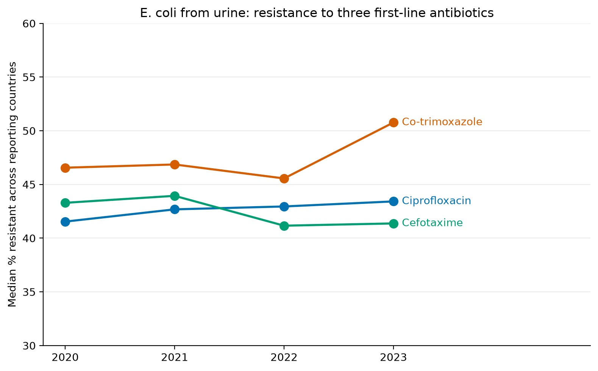
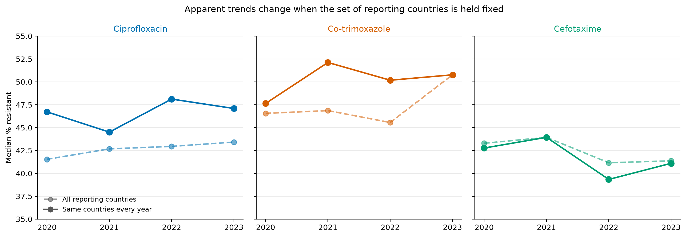
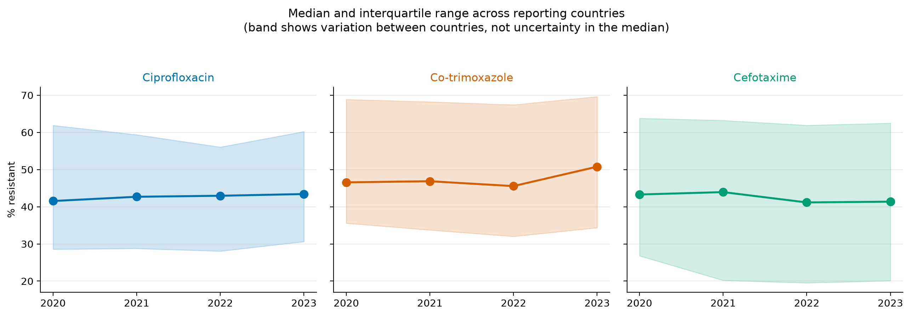
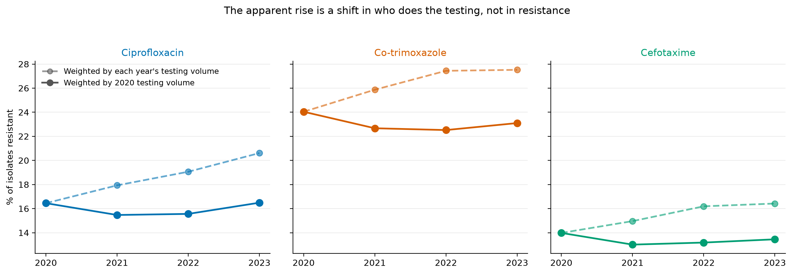

# How you summarise WHO GLASS data decides whether *E. coli* urinary resistance looks like it is rising

A methodological check on four years of WHO surveillance data, 2020–2023.

## Question

*Escherichia coli* causes most urinary tract infections, which are usually treated
empirically — the antibiotic is chosen before any culture result exists. So whether
resistance to the first-line drugs is rising bears directly on prescribing.

WHO reports that global trends in urinary *E. coli* resistance are broadly stable.
But a global figure has to be computed somehow, and GLASS is a system where both
the set of reporting countries and the volume each country tests change every year.
This analysis asks:

> Between 2020 and 2023, does *E. coli* urinary resistance rise — and does the
> answer depend on how the global figure is computed?

It does.

## Data

WHO Global Antimicrobial Resistance and Use Surveillance System (GLASS), downloaded
from the GLASS dashboard (https://worldhealthorg.shinyapps.io/glass-dashboard/).

Four CSV exports, one per year 2020–2023, each filtered to infection type *urinary
tract*, pathogen *Escherichia coli*, region *all*. Each row is one country and one
antibiotic, giving isolates with interpretable AST results, isolates resistant, and
the percentage. Combined: 2,300 rows.

Three antibiotics were selected as those most often prescribed empirically for UTI:
**ciprofloxacin**, **co-trimoxazole** and **cefotaxime**. That subset is 667 rows,
of which 18 were dropped for having fewer than 30 isolates tested.

Raw exports are not committed; see *Reproducing*.

## Method

1. Each export holds three stacked blocks. The analysis block is located by its
   `Data for boxplots` marker rather than a hard-coded line number.
2. The year is read from each filename; the four years are concatenated.
3. Country-years with fewer than 30 isolates tested are dropped — a percentage from
   a handful of isolates is noise, and one small country can otherwise move a median.
4. Resistance is then summarised four ways, each answering a different question:

| Summary | Question it answers |
|---|---|
| Median across all reporting countries | What does the typical reporting country look like? |
| Median across a **balanced panel** (countries reporting in all four years) | Did resistance change, holding the country set fixed? |
| **Pooled**: total resistant ÷ total tested | What does the typical tested isolate look like? |
| **Fixed-weight**: countries weighted by their 2020 testing volume | Did resistance change, holding both the country set *and* the weights fixed? |

5. Change within the balanced panel is tested per country (2023 − 2020) with a
   Wilcoxon signed-rank test — 42 paired observations rather than four annual
   medians.

### Validation

- Medians computed from the raw data reproduce the median values WHO states in the
  summary blocks of the same files (ciprofloxacin: 40.91, 42.68, 42.95, 43.63).
- Percentages computed from raw counts reproduce WHO's percentage column to within
  5e-10, the rounding limit of the published figures.

## Findings

### 1. No detectable change in resistance, in any of the three antibiotics

Within countries reporting in all four years, testing each country's own change
from 2020 to 2023:

| Antibiotic | countries | median change | rose / fell | p |
|---|---|---|---|---|
| Ciprofloxacin | 42 | +0.70 | 26 / 16 | 0.085 |
| Co-trimoxazole | 35 | −0.96 | 12 / 23 | 0.359 |
| Cefotaxime | 33 | −0.36 | 16 / 17 | 0.751 |

None significant. With 42 countries this analysis is underpowered to detect a change
of one or two percentage points, so this is *no detectable change*, not *no change*.

### 2. Apparent rises come from two separate artefacts

**Which countries report.** Co-trimoxazole's median rises 5.2 points in 2023 across
all reporting countries (45.56 → 50.77) but 0.6 points in the balanced panel
(50.18 → 50.77). Eleven countries entered the dataset that year.

**How much each country tests.** The isolate-pooled estimate rises monotonically for
all three drugs — but only while countries are re-weighted each year by that year's
testing volume. Freeze the weights at 2020 volumes and the rises vanish:

| Antibiotic | 2020 | 2023 (weights float) | 2023 (weights frozen) |
|---|---|---|---|
| Ciprofloxacin | 16.45 | 20.61 | 16.49 |
| Co-trimoxazole | 24.04 | 27.52 | 23.10 |
| Cefotaxime | 13.98 | 16.42 | 13.45 |

Every drug gains two to four points on floating weights and gains nothing, or loses
ground, once the weights are frozen.

Pakistan illustrates the mechanism: its ciprofloxacin testing grew from 5,351 to
58,122 isolates while resistance stayed near 70%. Its share of the global isolate
pool rose roughly elevenfold without its resistance changing at all.

### 3. The four summaries disagree by more than twenty points

In 2023, ciprofloxacin resistance is 43.4% by country median, 47.1% in the balanced
panel, 21.4% pooled across isolates, and 16.5% at fixed 2020 weights. All four are
correct. They describe different populations: the typical reporting country, the
typical consistently-reporting country, the typical tested isolate, and the 2020
testing population held constant.

None of them is "global resistance."









## A note on what is *not* an artefact

The rise in the floating-weight pooled estimate is a nuisance for measuring trend,
but it is a real fact about surveillance: global testing capacity is expanding into
higher-resistance settings. That is worth knowing in its own right.

## Limitations

- **Four years is short**, and the window spans COVID-19, when routine urine
  culturing and surveillance reporting were disrupted in many countries.
- **Underpowered.** 33–42 countries cannot detect small changes.
- **The balanced panel is not representative.** Ciprofloxacin resistance is ~47% in
  the 42 consistent reporters against ~42% across all countries, so those 42 are
  systematically different from the full set.
- **The fixed-weight estimate is dominated by 2020's heaviest testers**, which are
  mostly high-income, low-resistance countries. It answers "did resistance change
  where testing was already concentrated?", not a global question.
- **Between-country variation dwarfs the trend.** The interquartile range spans
  roughly thirty percentage points in any given year; the movement over four years
  is one to five.
- **Surveillance coverage and laboratory quality vary** between countries, so
  differences may partly reflect how countries test rather than what they find.
- Descriptive analysis of aggregated national figures. No causal claim is made.

## Repository

```
├── data/        the four GLASS exports (not committed)
├── notebooks/   01_load_and_combine.ipynb
├── figures/     four charts produced by the notebook
└── results/     summary tables produced by the notebook
```

## Reproducing

```bash
conda create -n ampml -c conda-forge --override-channels \
  python=3.11 pandas scipy matplotlib jupyterlab
conda activate ampml
jupyter lab
```

Versions used: Python 3.11.18, pandas 3.1.1, scipy (via scikit-learn 1.9.1),
matplotlib 3.11.2.

To obtain the data: open the GLASS dashboard, go to the AMR section, filter to
infection type *urinary tract*, pathogen *Escherichia coli*, region *all*, and export
one CSV per year for 2020–2023 into `data/`. The notebook reads whatever CSV files it
finds there and takes the year from each filename.

## Source

Global antibiotic resistance surveillance report 2025: WHO Global Antimicrobial
Resistance and Use Surveillance System (GLASS). Geneva: World Health Organization;
2025.

Figure colours follow the Okabe–Ito palette, checked for colour-vision deficiency.

## Author

Ayesha Nasir — github.com/Ayesha-Nasir313
